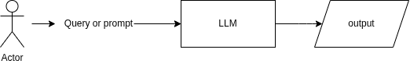
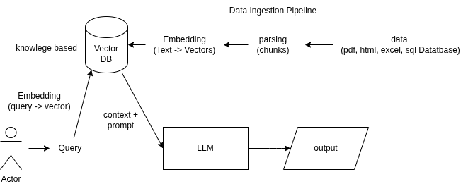
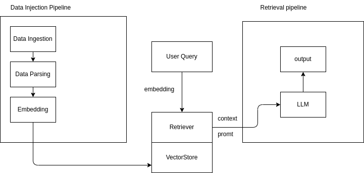
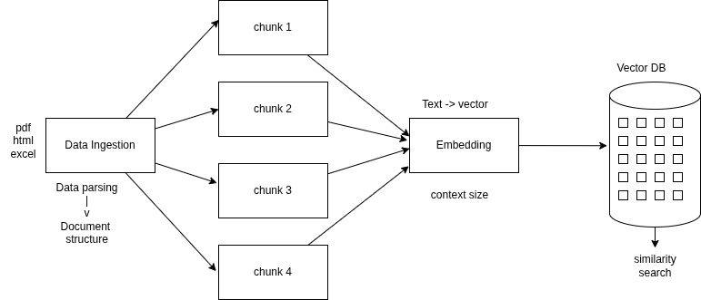

## Crash course for RAG(Retrieval Augmented Generation)

Will be discuss about the RAG compeletely from scratch where we Will be talking about the entire pipeline fom data injection to retriveal pipleline to output generation.
How to use LLM models,
HOw to use embedding models in this along with right strategy of using chunkings and many more things.
Will be dive into the theoritcal and practical implementation.
We will start with basic implementation and then as we go in the advanced section we will also implement the modular coding

The main aim of the modular coding is to link the entire pipeline in a way so that you will understand how rag actually works and implements it in your company usecases.

Important note that
90% of the use case that currently been worked in all companies are specially realated to RAG.

## What is RAG?
It's a techniqe used with **LLMs(Large Language Models)** to make their answers more accurate and up-to-date by combining two steps:

**1. Retrieval (finding information)**
The system first searches for relevant information from external sources like:
- Databases
- Documents
- Websites

**2. Generation (creating the answer)**
Then it feeds that information into an LLM (like ChatGPT), which uses it to generate a better, more grounded response.

### Normal LLM


with finetuning data(training the data), it will cost hight and will got some disadvantages:
- hallucinating

so inorder to prevent from this we use the  RAG method

Difference on RAG and Finetuning
lets train a student(llm model eg-chatgpt)
In finetuing method:
- You teach the student in advance.
-You give many examples
- The student learns and remembers the style
- During the exam, student will answer what student remember(i.e trained)


In RAG = Open book exam
- You don’t train the student again.
instead
- During the exam, you give them a book (data)
- They look into it and answer

## LLM with RAG



Here one method in used which is **data ingestion pipeline**. 
There will try do the **data ingestion pipeline**. 

1. first, we will have **data**
2. from data we will do some kind of **parsing**
3. from parsaig will do the **embedding**
4. Then we will store in **vector store**

Data can be any format(unstructured format) that can be in pdf, excel, html, sqldatabase.

Data parsing step is the most important
here is chunking of unstructured data(i.e divide the data).
The chunk data get stored in the vectore store or vector db

In embedding model, it convert text(chunks) to vectors
vector is the numerical representation for text so that you will be apply algorithm like simliarity search techniques(already available) which will help in similar kinds of result, on a specific query can be retrive from the particular databases.
embedding model are: openAI embedding model,

At the end of the **data ingestion pipeline** you will be able to store the data into vector database inform of vector.


 
The query is given to the vector db then from that get promt + context.
then it passed to the LLM
for example:
**HR RAG**
Step 1: USer Query 

```
What is the leave policy?
```

Step 2: Vector DB returns context
Example retrieved context:

- Employees get 20 paid leave days per year
- Sick leave: 10 days per year
- Casual leave: 5 days per year
- Unused leave can be carried forward up to 10 days

Step 3: Build the prompt
This is what gets sent to the LLM:

```
Answer the question based on the HR policy below:
Context:
- Employees get 20 paid leave days per year
- Sick leave: 10 days per year
- Casual leave: 5 days per year
- Unused leave can be carried forward up to 10 days
Question:
What is the leave policy?
```
👉 This full thing = prompt (query + context)

Step 4: Final Answer (LLM output)
The leave policy allows employees 20 paid leave days per year, including 10 sick leave days and 5 casual leave days. Unused leave can be carried forward up to 10 days.

This is an Traditional Rag

### Why RAG is useful:
✅ More accurate answers
✅ Uses real-time or private data
✅ Reduces hallucinations (made-up info)
✅ No need to retrain the whole model


> Rag based apps is Percexity


## Structure of the RAG



Agenda

1. Document Structure
2. Complete Rag Pipeline 
    - Data ingestion pipeline
    - Query ingestion pipeline

### Data ingestion pipeline




### Making a traditional Rag

First we will how we can convert to data structure. for that foloow the steps:

**Step 1**: Go to vs code

**Step 2**: Go to one specific folder like `rag` and Initialize particular workspace with this command

```zsh
uv init
```

> If you don't know about uv you can see this [link](./uv.md)

**Step 3**: Create an virtual env  and activate it
```zsh
uv env
source .venv/bin/activate
```

**Step 4**: Create file `requirement.txt`
and add this below:

```
langchain
langchain-core
langchain-community
pypdf
pymupdf
```

**step 5**: inorder install this packages. Run following command:

```zsh
uv add -r requirements.txt
```

**step 6**: Create folders named `data` and `notebook`

```zsh
mkdir data notebook
```

**Step 7**: In order along with the jupiter notebooks

```zsh
uv add ipykernel
```

**step 8**: Then choose kernal as `.env python`

**step 9**: Create a file in folder `notebook` named as `document.ipynb`

**step 10**: Then do the code as in [file](../notebook/document.ipynb)

By the end of this file you will know how to structure the data i.e `Document Structure`


### Next is how we can do the chunking:

[chunking the pdf files](../notebook/pdf_loader.ipynb)


### Embedding
You can use any model
for this we are using the open source models
going to do the modular coding
